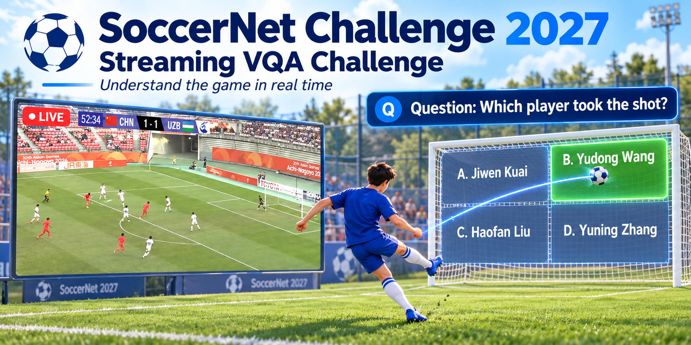
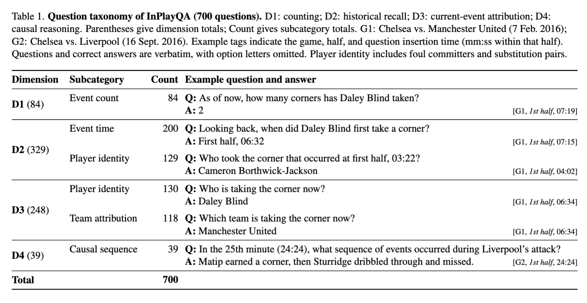

# SoccerNet Challenge 2027 — Streaming Visual Question Answering (VQA)

📢 **Streaming Visual Question Answering (VQA) Challenge!** 🚀

📅 **Submission deadline:** April 25, 2027, 23:59 Anywhere on Earth (AoE; UTC−12).\
👥 **Task leads:** Jiayuan Rao and Ahmad Sait

🏠 [Challenge website](https://www.soccer-net.org/challenges/2027) · 🗂️ [Data on Hugging Face](https://huggingface.co/datasets/SoccerNet/SN-VQA-2027) · 💻 [Baseline](baselines/README.md) · 📚 [Rules](RULES.md) · 📊 [Evaluation server](https://www.codabench.org/competitions/18329/) · 🧮 [Evaluation code](evaluation/README.md)

  

## 🚀 What is new in 2027?

The [2026 SoccerNet VQA Challenge](https://github.com/jyrao/SoccerAgent/blob/main/Challenge.md) evaluated understanding of short video clips, images, and text. The 2027 edition moves to **long, continuous match broadcasts**: questions arrive while the match is playing, so a system must understand the current action, remember earlier events, and revise uncertain observations over time.

| 2026 VQA | 2027 Streaming VQA |
| --- | --- |
| Short, pre-cut clips | Long, continuous broadcasts |
| Answer after seeing the full clip | Answer at a specific moment |
| Local clip understanding | Evolving full-match memory |
| Offline sample-by-sample QA | Live-style, temporally constrained QA |

This setting supports live sports assistants that answer **what is happening now**, **what happened earlier**, and **how the match has developed so far**.

## 🎯 The task

Answer multiple-choice questions as a soccer match unfolds. At question time `t`, a method may use video observed up to `t`, the question and options, and permitted pre-match metadata. Text-only methods that use the question and options without video are eligible on the same leaderboard. Future frames are prohibited.

Memory, cached features, retrieved frames, and model updates must obey the same temporal cutoff. Permitted metadata includes team names, kit colors, rosters and jersey numbers, initial lineups and positions, and playing directions once established from the broadcast. See the [full rules](RULES.md) for the input restrictions.

## 📦 Data

The [SN-VQA-2027 dataset](https://huggingface.co/datasets/SoccerNet/SN-VQA-2027) uses OpenSportsLib OSL JSON. This task provides test and challenge sets, with no separate training or validation set. This repository includes [test questions and labels](data/test_GT.json) for 4 halves and 700 questions, [challenge questions without labels](data/challenge_public.json) for 10 halves and 1,158 questions, and [baseline predictions](data/README.md) for both. Challenge answers are withheld for evaluation.

The questions cover counting, historical recall, current-event attribution, and causal reasoning. Both splits contain six scoring subcategories: counting, recall event time, recall event player, event team, event player, and causal reasoning.

*The figure illustrates the 700-question public test set. The challenge split uses the same six scoring subcategories with different question counts.*

See the [data guide](data/README.md) for the four files and the [evaluation guide](evaluation/README.md) for prediction format and scoring.

## 🧠 Baselines

We provide two starting points. The [text-only API baseline](baselines/baseline_osl.py) answers from the question and options without inspecting video and writes OSL predictions. Text-only methods are eligible on the same leaderboard. The [MatchLive repository](https://github.com/Becomebright/MatchLive) provides the corresponding streaming-video baseline, combining visual perception with revisable match memory.

The [baseline guide](baselines/README.md) explains both approaches, how to generate text-only predictions, and how to score the included reference predictions.

## 🧮 Evaluation

The [evaluation guide](evaluation/README.md) documents the single script used for local evaluation and CodaBench scoring. The ranking score is the unweighted mean of the six subcategory accuracies. Four-category averaging is available for analysis with `--average-by category`.

For each subcategory, divide its correct answers by its question count, then average the six accuracies equally. Unanswered predictions count as incorrect. The included test predictions score **41.76%** under this metric.

## 🚨 Core rules

- **Visual-only:** no broadcast audio, speech recognition, commentary transcripts, audio-derived subtitles, or alternative audio sources.
- **Streaming-only:** use only information available up to the question timestamp, including in memory and cached features. Future frames, post-match information, reference annotations, and ground-truth answers are prohibited as prediction inputs.
- **Model APIs allowed; web retrieval prohibited:** local models and remote LLM/VLM/agent APIs are allowed. Disable browsing, search grounding, and external match-information retrieval in every model and tool.
- **Technical report required:** document models/APIs, prompts, configurations, data sources, reproducible implementation details, and how the method enforces these restrictions.

Read [RULES.md](RULES.md) for the complete requirements, permitted metadata, and submission validation policy.

## 📄 Reference paper

The reference paper has not been released yet. The paper link, title, authors, and citation will be updated here after the official release.

**Paper:** [arXiv placeholder](https://arxiv.org/) · **Citation:** coming soon

## 🏆 Submission

Official evaluation takes place on **CodaBench**. Submit predictions for every challenge question using the OSL JSON format, with an option ID or `null` in each `prediction` field.

**Competition:** [Streaming VQA evaluation server](https://www.codabench.org/competitions/18329/) · **Example prediction JSON:** [`challenge_submission.json`](data/challenge_submission.json) · **Submission packaging and phases:** follow the competition page; repository instructions will be updated when confirmed.

The public test set supports development and local evaluation. Hidden challenge answers determine the official ranking. Include a technical report as described in the [rules](RULES.md).

## 🗓️ Timeline

| Milestone | Date / status |
| --- | --- |
| Dataset release | October 7, 2026 |
| Baseline release | October 11, 2026 |
| CodaBench | October 8, 2026 |
| Paper release | TBD |
| Final submission deadline | **April 25, 2027, 23:59 AoE (UTC−12)** |
| Results and presentation | TBD |

Additional dates will be announced here and on the [SoccerNet Challenge 2027 page](https://www.soccer-net.org/challenges/2027).

## 💬 Questions and discussion

Join the [SoccerNet Discord community](https://discord.gg/cPbqf2mAwF) for announcements, rule clarifications, and team discussion.

## 🙏 Acknowledgments

We thank **Shangzhe Di, Yirong Hu, and Tianlin Gui** for their help with the benchmark and baselines, and the SoccerNet and OpenSportsLab communities for their support.
